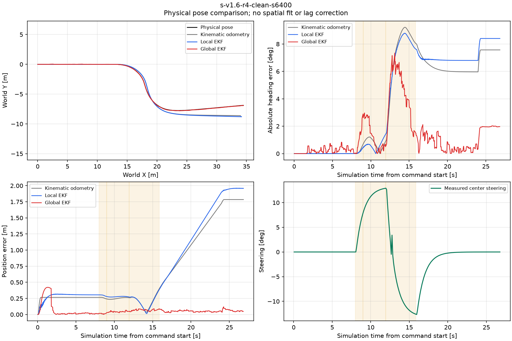
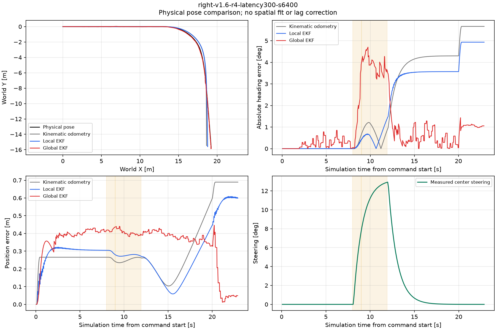
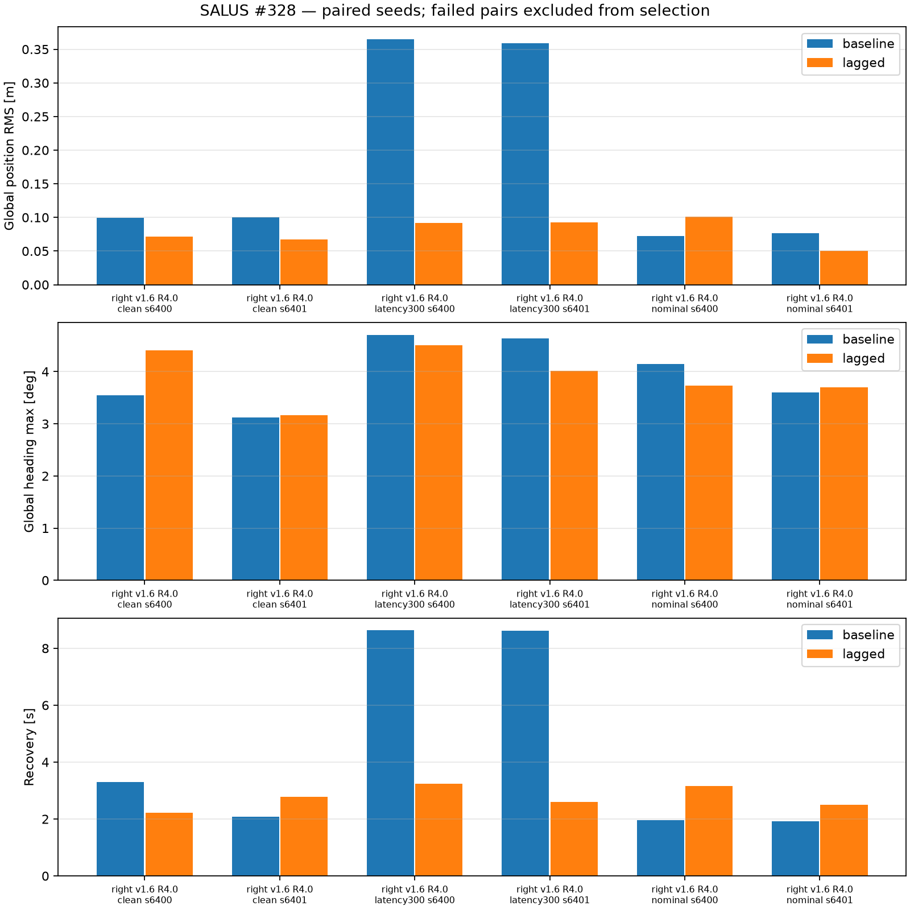
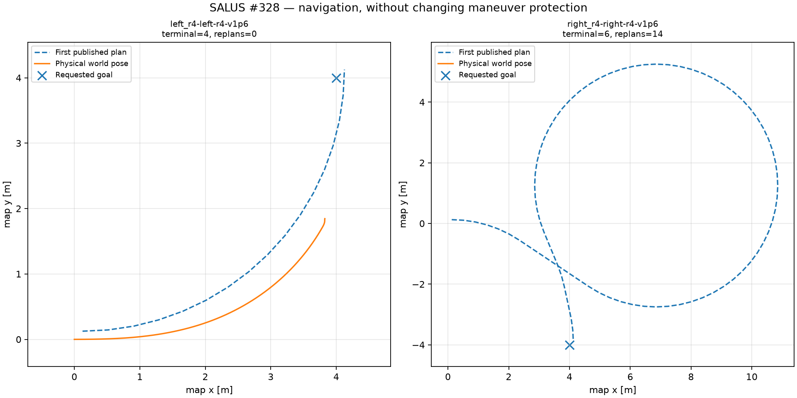

# #328 — resultados de la primera campaña de giros y EKF compensado

Campaña realizada en PC con ROS2 Humble/Fortress, sin Jetson, hardware,
movimiento real, merge ni despliegue. Recomendación de esta primera campaña:
**conservar las máscaras y los defaults del EKF**. El tratamiento de datos atrasados mejora mucho el caso
GNSS300 ms, pero incumple la no regresión nominal. Tampoco se promueve un radio
menor ni velocidad de producto mayor por estos ensayos.

El operador aclaró que el objetivo de la rama sigue siendo mejorar la
localización y habilitar giros automáticos más pronunciados y mayor velocidad
si se demuestra estabilidad. Esta recomendación sobre una variante del EKF no
cierra esos objetivos ni descarta cambios de planner/controlador. La matriz Nav2
inicial tiene límites de adquisición y llegada que deben resolverse antes de
atribuir un techo a la navegación. Ver la continuación de objetivos en la
[intención](../intent/ekf-turns-2026-10-18.md).

## Qué se corrigió y qué significa la referencia

La referencia nueva usa `/simulation/ground_truth`, pose física `worldPose` de
Fortress, observada pasivamente. Se corrigieron dos errores del simulador:
Twist.angular.z recibía ángulo de dirección cuando Fortress requiere yaw-rate;
`wheelbase` era ignorado y se sustituyó por `wheel_base=0.94`, con
`kingpin_width=0.75`. No se cambiaron dimensiones físicas ni el backend UART.
[ADR0017](../../decisions/0017-simulation-motion-reference.md) documenta el
contrato, caracterización antes/después y fuentes upstream.

**Se retira la interpretación de los anteriores ~2° como precisión frente a
pose física independiente.** `/odom_raw` integra articulaciones y alimenta
IMU/rueda simuladas. Esos ~2° describen acuerdo con esa referencia cinemática;
los archivos históricos se conservan intactos, con 93 hashes en
[preserved-history-sha256.json](preserved-history-sha256.json).
`kinematic-precheck/` conserva también la exploración inicial de esta campaña,
no usada para elegir tuning físico. Corregir el simulador cambia el tracking;
eso no se atribuye a una mejora del filtro.

Las fuentes revisadas fueron #328 actualizado, #60/#266 (múltiples máscaras
locales, sin ganador), #61/#268 (una única autoridad global de yaw-rate mediante
odom local), PR325/327, PR329 y ADR0016. No se repitió la búsqueda de máscaras ni
se duplicó yaw-rate. Base main `d6bf67d`; infraestructura física `0de5f53`;
los commits y hashes de fuentes/recetas/parámetros efectivos están por trial.

Compensación activa una vez: montaje TF `(0.66,0.20,0.62)` m, mapper sim resta
brazo rotado con heading map al stamp GNSS y publica `/gps/odometry_map`, entrada
del EKF global. No se fusiona además `/odometry/gps`. El camino real conserva
`gps_link` y compensación nativa navsat. El observador físico nuevo no alimenta
sensores, heading, compensación, EKF, control ni TF.

## Diseño y validez

[La intención](../intent/ekf-turns-2026-10-18.md) registra hipótesis y criterios
antes de variar parámetros; [README](README.md) da comandos completos.
Dos workers, seis CPU cada uno, dominios/particiones/puertos/runtime aislados
mediante el harness existente. No se iniciaron stacks paralelos manuales.

Referencia física: 71 intentos, **70 completos con parámetros efectivos**;
un capture completo falló al exportar ListParameters de salus_controller y se
conserva excluido de agregados de éxito. Piloto físico 2/2; variante 6/6;
confirmación con seeds reservadas 15/16, otro fallo de exportación de parámetros.
Los dos fallos no se borran ni se sustituyen por nuevas corridas favorables.
Las capturas de esos fallos son numéricamente analizables, pero no elegibles
para seleccionar una variante. `outcome` distingue fallo de harness de captura.

La exploración cinemática inicial planificaba48:42 completados,2 parciales y4
no ejecutados al detectar el contrato incorrecto del simulador. Su inventario
conserva status, ausencia de GNSS absoluto en pruebas0.8 m/s y errores del
harness; no integra la tasa de éxito de la referencia física nueva.

Errores de localización por header stamp, yaw envuelto, interpolación física
con gap≤0.2 s, sin extrapolar, ajuste espacial, restar sesgo inicial o corregir
lag. map/odom usan datum/spawn del mundo conocido. Se informa el lag aparte con
soporte común; una recta de yaw casi constante no identifica un retardo.
Fases recta/entrada/curva/salida son ventanas de comando; los intervalos de giro
físico fuerte y sus errores figuran aparte. Recuperación es el primer intervalo
continuo de1 s con heading≤2° y posición≤0.25 m; es descriptiva y censurada si
no ocurre, no un umbral de seguridad.

## Referencia actual, sin tuning

R4, curvas de90° solicitadas tras8 s de recta, seeds6400/6401. Los rangos son
mínimo/máximo observado entre dos repeticiones; no intervalos de confianza.
Cada valor primario incluye la captura completa, sin corregir desfases.

| Velocidad | Lado | Heading global máximo ° | Heading global RMS ° |
|---|---|---:|---:|
|1.2 m/s|derecha|3.12–3.56|1.08–1.09|
|1.2 m/s|izquierda|2.76–3.62|1.02–1.15|
|1.6 m/s|derecha|3.12–3.55|1.12–1.13|
|1.6 m/s|izquierda|2.96–3.37|1.17–1.26|
|1.8 m/s|derecha|3.18–3.71|1.16–1.26|
|1.8 m/s|izquierda|3.37–3.96|1.23–1.30|

La recta1.6 m/s obtuvo máximo global1.00–1.50°, RMS0.33–0.40°, posición
RMS0.053–0.072 m. Las pequeñas oscilaciones tuvieron máximo0.96–1.53°,
RMS0.33–0.41° y ninguna transición a STRONG_TURN ni reinicio repetitivo de
ventana (generación0). En giros fuertes hubo **cero muestras válidas de heading
GPS**: suspensión/readquisición funcionan sin congelar IMU/EKF.

La S es más exigente: máximo global6.89–7.34°, RMS1.99–2.05°, posición
RMS0.093–0.098 m. El local acumuló máximo7.90–8.79° y posición máxima1.74–1.96 m.
La secuencia de inversión y readquisición merece seguimiento físico; no se
esconde ajustando covarianzas. El arco amplio180° R8, sólo estimador, obtuvo
máximo global3.14° y local10.86°, con posición RMS global0.084 m/local0.998 m.
No acredita que navegación acepte una U.

Disponibilidad de toda la referencia: gap máximo IMU0.042 s, local0.084 s y
global0.105 s, con continuidad por trial y cobertura de bordes registrada.
No se confundieron ausencia de muestras o estimación congelada con precisión.
Las tablas completas incluyen máximos/RMS locales y globales, posición,
fases, covarianzas observadas, lag y readquisiciones en
[physical-reference/summary.csv](physical-reference/summary.csv) y
[summary.json](physical-reference/summary.json).

## Velocidad y radio experimental

Se respetó el máximo manual configurado30° mediante un wrapper exclusivo de
simulación, con readback. El automático conserva18°; planner de producto R4.
Se pidieron R3/R2/R1.65 a1.2/1.6/1.8, ambos lados, dos semillas. R1.65 se
sostuvo6 s para acercarse al límite y puede describir una vuelta: ensayo aislado
del estimador, explícitamente no navegación integral.

R2 a1.8 produjo máximos globales aproximadamente5.85–6.15°. R1.65 sostenido
llegó a8.44° global en clean y9.07° con perfil nominal; en nominal derecha1.8
los máximos fueron7.40–7.87°.
El radio físico sostenido mediano fue aproximadamente2.03 m, no1.65 m. Las
juntas interiores y el sistema Ackermann limitan el radio central alcanzado;
no se eliminó su clamp ni se aumentó el máximo manual. `motion` registra radio
geométrico de tres poses físicas, p05/mediana/p95 y dirección medida. El mínimo
instantáneo transitorio no es el radio sostenible ni una promesa del robot real.

El tracking del modelo de comandos está separado: por ejemplo en S la distancia
RMS física al modelo temporal solicitado ronda1.01–1.06 m; en180° R8 es3.24 m.
La curva no es exactamente la cinemática ordenada debido al modelo/actuadores.
Estos errores no se presentan como error EKF ni se intentan corregir con tuning.

## Perturbaciones y atribución

Perfiles explícitos por trial, seeds iguales: gyro bias0.002 rad/s y ruido0.005;
rueda escala1.005 y ruido0.015 m/s, dirección bias0.15°/ruido0.20°; GNSS con
latencias100/300 ms; cortes4 s repetidos cada12 s; nominal combinado existente.
Son intervenciones sintéticas moderadas para sensibilidad, no calibración de
sensores reales. Se probaron primero individualmente.

| Perfil, derecha1.6 R4 | Heading máximo ° | Heading RMS ° | Posición RMS m |
|---|---:|---:|---:|
|clean|3.12–3.55|1.12–1.13|0.099–0.101|
|gyro|2.94–3.15|1.06–1.10|0.062–0.064|
|rueda/dirección|3.15–4.03|1.19–1.21|0.064–0.075|
|GNSS100 ms|3.31–3.73|1.17–1.19|0.101–0.126|
|GNSS300 ms|4.64–4.70|1.58–1.60|0.359–0.365|
|cortes GNSS|3.91–4.42|1.61–1.62|0.111–0.128|
|nominal combinado|3.60–4.15|1.10–1.26|0.073–0.076|

Que un perfil perturbado mejore algún número aislado no demuestra ventaja del
ruido: hay asincronía de arranque/transportes y sólo dos repeticiones. El GNSS
atrasado sí tiene una degradación posicional consistente y atribuible. Con300 ms
la recuperación tras curva tarda8.62 s, prácticamente hasta detenerse; los
cortes conservan streams del EKF y su recuperación tras cada restitución GNSS
se registra en `gnss_outages`.

## Variante temporal y confirmación reservada

Una sola intervención: EKF global `smooth_lagged_data=true` y
`history_length=1.0`, sin cambiar sensores, ruido, geometría, planner,
controlador, máscaras o Q. Configuración experimental por trial; referencia
intacta. Se eligió por el fallo GNSS300 ms, no por barrer parámetros.

Aceptación congelada en [acceptance-baseline.json](acceptance-baseline.json):
mejorar mediana RMS posición GNSS300 ms más que max(10% baseline,2×rango
baseline)=0.0362 m; no empeorar RMS yaw, máximos, rectas, recuperación ni
continuidad fuera de la variabilidad observada por perfil. Es un criterio
operativo descriptivo con n2, no una prueba estadística.

| seeds6400/6401 | RMS posición baseline → variante m | Recuperación baseline → variante s |
|---|---|---|
|clean derecha1.6 R4|0.099/0.101 →0.072/0.067|3.30/2.08 →2.22/2.78|
|GNSS300 ms|0.365/0.359 →0.092/0.093|8.63/8.62 →3.25/2.60|
|nominal derecha1.6 R4|0.073/0.076 →0.101/0.050|1.96/1.92 →3.16/2.49|

GNSS300 ms mejora~74% RMS posición. Pero el máximo heading clean empeora
3.55→4.41° en seed6400 y la recuperación nominal empeora en ambas semillas,
fuera de la variabilidad previa. **Variante descartada como default general.**

Confirmación reservada seeds6402/6403 (recta, derecha300 ms, izquierda nominal,
derecha nominal1.8 R1.65 manual):300 ms vuelve a mejorar posición
0.366/0.356→0.079/0.090 m y recuperación8.62/8.67→2.58/3.23 s. La izquierda
nominal seed6402 empeora RMS posición0.072→0.091 m y recuperación2.23→2.88 s;
el manual seed6402 mejora posición0.086→0.075 m pero recuperación3.65→3.95 s.
El par manual seed6403 tiene un fallo de exportación de baseline y queda no
elegible. La recta no muestra una ventaja consistente. La confirmación sostiene
el beneficio condicionado a atraso medido y el rechazo de una promoción global.

[variant-paired.json](variant-paired.json) y [holdout-paired.json](holdout-paired.json)
retienen cada par, elegibilidad, disponibilidad y recuperaciones; las capturas
compactas permiten recalcular todo. Una futura opción temporal debería evaluarse
contra latencia medida en hardware y con campaña nominal más amplia.

## Navegación y protecciones

Las matrices se ejecutaron completas: R4 **5/9 gates funcionales**,6/9
terminales Nav2 exitosos; R3 experimental **3/6 gates funcionales**,5/6 terminales
exitosos y1/6 fallo de setup. Se conserva cada intento y su causa.

| Campaña | Resultado observado | Atribución |
|---|---|---|
|R4 recta1.2/1.6|2/2 funcionales; distancia final física~2.32 m|Tolerancia operacional heredada2.5 m; no acredita precisión0.25 m|
|R4 recta1.8|Nav2 success; sin plan capturado, gate falla|Limitación de captura/discovery; no se borra ni se declara éxito integral|
|R4 izquierda, tres velocidades|3/3 funcionales; distancia final~2.16 m|Sin autoridad GNSS absoluta inicializada en toda la curva|
|R4 derecha, tres velocidades|0/3; PLANNER_LOOP,14 replans cada una, NEEDS_OPERATOR|Protección detiene correctamente; distancia recorrida0 m|
|R3 izquierda, tres velocidades|3/3 funcionales; distancia final2.25–2.28 m|Tracking RMS físico~0.50–0.52 m; GNSS absoluto no adquirido|
|R3 derecha1.2/1.8|Nav2 success, arrival falla:2.519/2.536 m|Mejora factibilidad geométrica, no precisión/seguimiento suficiente|
|R3 derecha1.6|Fallo de setup/readback velocidad tras set exitoso|Sin evaluación física; cuenta como fallo, sin sustitución|

Los ensayos de curvas arrancan directamente desde reposo, sin recta de
adquisición. El mapper informa `absolute_heading_uninitialized`; esos números
no son validación GNSS/EKF integral. Los errores casi cero de las derechas R4
son de un vehículo **inmóvil**, no una mejora. En R4 izquierda los máximos de
heading global frente a pose física son2.90–3.39°, pero sin GNSS absoluto.
Las derechas R3 móviles llegan a5.28–5.61°. Esto refuerza conservar separados
arranque/localización, factibilidad del planner y tracking.

La velocidad configurada es un límite: rectas alcanzan1.2/1.6/1.8; izquierdas
R4 alcanzan máximos1.24/1.46/1.59 m/s e izquierdas R3~1.24 m/s en los tres
límites. No se afirma haber completado una curva Nav2 a1.8 sostenidos por
configurar ese límite. La campaña aislada del estimador sí ordena esas velocidades
y conserva velocidad física medida por muestra.

Se conservaron los gates funcionales originales, tolerancia operacional2.5 m y
precisión física por separado. No se ajustó el EKF para salvar fallos de llegada.
El tracking causal usa el último plan publicado recibido antes de cada pose;
no compara toda la trayectoria con un replan futuro ni afirma conocer el plan
activo interno del controlador. El snapshot final queda report-only. CSV
retienen stamps de publicación/recepción. Ver
[navigation-r4-observations.json](navigation-r4-observations.json),
[navigation-r3-observations.json](navigation-r3-observations.json) y los bundles
con readbacks, planes, comandos, path_health y debug GNSS.

El smoke de guard con reloj ROS pausado pasó stop, adopción de replan válido,
timeout monotónico, misión preservada y vías manual/cancel. Los tests existentes
rechazan el arco180° como PLANNER_U_TURN y los rulos/revisitas, admitiendo curvas
sin retorno y piernas de patrulla delimitadas por metas ordenadas. No se cambió
la política de PR329 ni se usó open-loop para eludirla en el producto.

## Verificación local y CI

Build14 paquetes y suite completa:1361 tests,0 errores/fallos,4 skipped; más
las pruebas de herramientas (incluye fallos de captura/exportación, pairing,
replay compacto y exclusión de pares fallidos). Los9 checks de aislamiento
pasaron antes y después de corregir el simulador. Los smokes de frontera y
el estado CI del head final se registran en validation/ y el PR.
Los cinco smokes locales pasaron: motion, localization canónico, safety,
navigation_core e integration.

Un CI intermedio falló porque README enlazaba este informe todavía no agregado
al commit; los seis smokes CI de ese SHA pasaron. La causa fue documental,
no una mejora de filtro. Se corrige incluyendo el informe versionado. También
se corrigieron fixtures y estilo del nuevo tracking causal antes de la suite
completa verde; no se ocultan las ejecuciones fallidas del desarrollo.

## Límites y validación física pendiente

IMU y rueda siguen compartiendo `/odom_raw` cinemático. La comparación física
revela esa dependencia; no convierte los sensores en realistas independientes.
No se usan innovations internas inventadas: las covarianzas se capturan, pero
el error externo no es una innovación del EKF. No hay equivalencia cuantitativa
con hardware ni certificado de seguridad a1.8 m/s/radio2 m.

Validación posterior con operador/E-stop y espacio libre: medir wheelbase y
máximo manual/radio real a baja velocidad, registrar RTK independiente,
stamps/latencias GNSS/IMU/rueda y TF del montaje; repetir recta→90°→recta ambos
lados a1.2/1.6, progresar a1.8 sólo si control/seguridad lo admiten, luego S y
cortes GNSS controlados. Comparar local/global contra referencia externa con
frames/tiempo fijos; separar tracking y guard. No cambiar máscaras antes de
explicar diferencias entre cinemática simulada y física medida.
